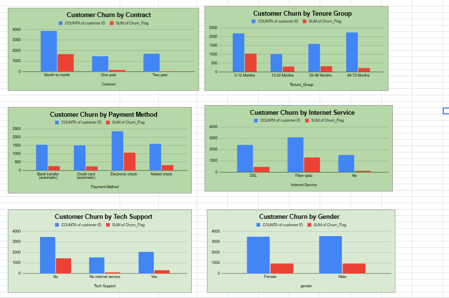
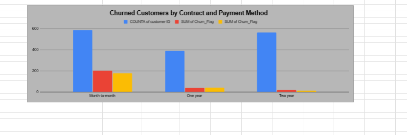

# 📊 Customer Churn Analysis and Retention Strategy

## 📌 Project Overview

This project analyzes customer churn in a telecommunications company using Google Sheets. The objective is to identify customer churn patterns, understand the factors associated with customer attrition, and provide actionable business recommendations to improve customer retention.

## 🎯 Project Objectives

- Analyze overall customer churn.
- Identify customer segments with high churn rates.
- Study the impact of contract types, tenure, payment methods, and services.
- Create KPIs, pivot tables, and an interactive dashboard.
- Provide data-driven recommendations for customer retention.

## 🛠️ Tools & Technologies

- Google Sheets
- Data Cleaning
- Pivot Tables
- KPI Analysis
- Data Visualization
- Business Analysis

## 📈 Key Performance Indicators (KPIs)

| KPI | Result |
|---|---:|
| Total Customers | 7,043 |
| Churned Customers | 1,869 |
| Overall Churn Rate | 26.54% |
| Average Monthly Charges | 64.76 |
| Total Charges | 16,056,168.70 |

## 🔍 Key Business Insights

1. **Contract Type:** Month-to-month customers have the highest churn rate (42.71%), while two-year contract customers have the lowest (2.83%).
2. **Customer Tenure:** Customers with 0–12 months of tenure show the highest churn rate (47.44%).
3. **Payment Method:** Electronic check users have a high churn rate (45.29%).
4. **Internet Service:** Fiber optic customers show a churn rate of 41.89%.
5. **Tech Support:** Customers without tech support have a higher churn rate (41.66%) than customers with tech support (15.17%).
6. **Senior Citizens:** Senior customers have a churn rate of 41.68%, compared with 23.61% for non-senior customers.
7. **Gender:** Female customers have a churn rate of 26.92%, compared with 26.16% for male customers.

## 💡 Business Recommendations

- Encourage customers to choose long-term contracts through suitable incentives.
- Improve onboarding and customer engagement during the first 12 months.
- Investigate service quality and pricing concerns among fiber optic customers.
- Promote automatic payment options.
- Improve awareness and accessibility of technical support services.
- Develop targeted retention strategies for high-risk customer segments.

## 📂 Project Structure

The project includes data preparation, KPI calculations, pivot table analysis, a dashboard, and business insights.

## 👨‍💻 Author

**Jaivardhan Singh**

GitHub: [@codersingh74](https://github.com/codersingh74)

## 📊 Business_Insights

---

*This project was created for practical learning and business analytics portfolio development.*
## 📊 Dashboard Preview

### Dashboard – Part 1

### Dashboard – Part 2

